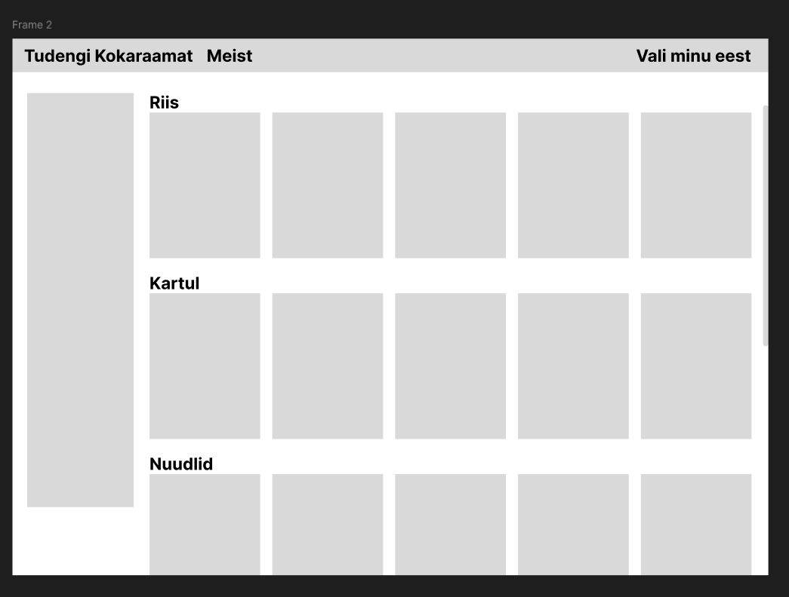

# sep-samma

Sissejuhatus erialasse veebilehe projekti tiim samma repo.

### Lehe selgitus

Tiim samma valis veebileheks teha tudengi kokaraamatu. Tudengitel sageli ei ole palju aega ja raha, seega siia kokaraamatusse soovime koguda retsepte, mis sobivad nende tingimustega.

### Funktsionaalsus

- Nimi
- Seletus (nice to have)
- Juhend
- Vajalikude vahendite filter
- Allergeenid / mitte meeldivad toidud
- Random nupp (nice to have)
- Lemmikud retseptid (nice to have)
- Pildid (nice to have)

### Lehed

- Retsepti list
- Detail vaade
- Koduleht

Vaatasime üle otsustatud käitumisnormid ja otsustasime, et need on ikka olulised meile ning praegu pole vaja midagi muuta.
